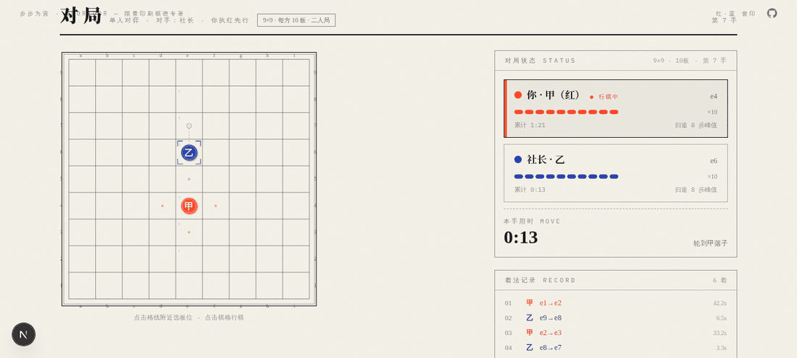
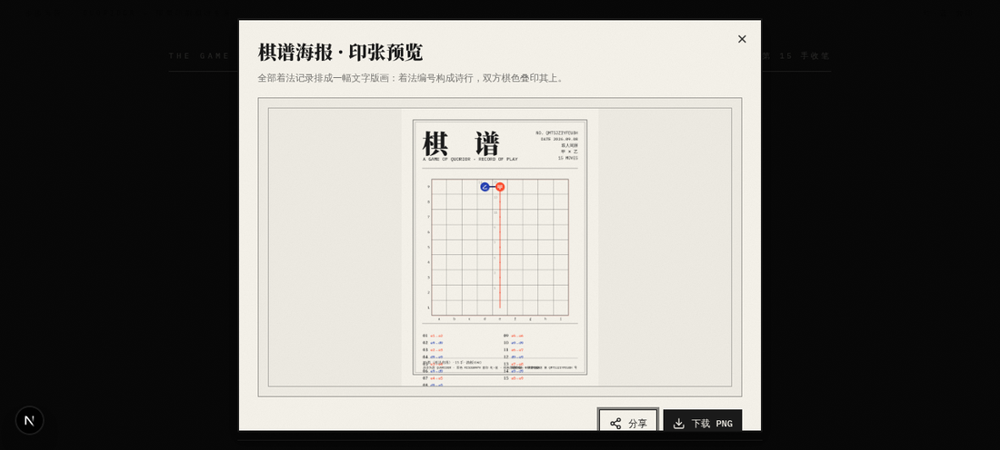
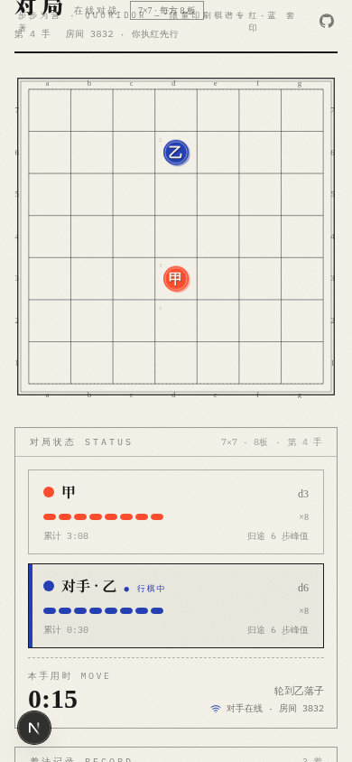

# 步步为营 · QUORIDOR

[](https://github.com/43aquarius/quoridor/actions/workflows/android-apk.yml)
[](https://github.com/43aquarius/quoridor/releases/latest)

> 一册会下棋的限量印刷棋谱专著 —— risograph 双色套印美学 × 完整 Quoridor 策略对弈。

网页版策略对弈游戏，基于经典桌面游戏 **Quoridor（步步为营）** 规则。整个应用被排版成一本「编辑部出品的限量棋谱专著」：封面、目录、编者按、档案馆一应俱全；纸白底、墨黑字、荧光红 / 钴蓝双色套印，0.5pt 细线棋盘，铅字棋子与铅条挡板，处处是印刷细节。棋盘尺寸、挡板数量、棋钟规格皆可自定义，支持单人对 AI、双人同屏、**四人围坐（本地 + 在线）**、在线对战四种模式。

- **在线开玩**：<https://d1n1c9rzwhe0-d.space.zhipuaidemo.cn/>
- **Android APK**：[Releases 下载](https://github.com/43aquarius/quoridor/releases/latest)（CI 自动构建，推送代码即出包，打 tag 即发版）
- **开源仓库**：<https://github.com/43aquarius/quoridor>

---

## 目录

- [它长什么样](#它长什么样)
- [玩法速览](#玩法速览)
- [功能特性](#功能特性)
- [快速开始](#快速开始)
- [部署](#部署)
- [自定义配置](#自定义配置)
- [架构与目录](#架构与目录)
- [在线对战协议](#在线对战协议)
- [AI 棋力](#ai-棋力)
- [Android APK](#android-apk)
- [测试](#测试)
- [技术栈](#技术栈)
- [许可](#许可)

---

## 它长什么样

<p align="center"></p>

<table>
  <tr>
    <td width="50%"></td>
    <td width="50%"></td>
  </tr>
  <tr>
    <th align="center">单人对弈 · 编辑部 AI</th>
    <th align="center">四人围坐 · 四色套印</th>
  </tr>
  <tr>
    <td width="50%"></td>
    <td width="50%"></td>
  </tr>
  <tr>
    <th align="center">在线对战 · 大厅与开房</th>
    <th align="center">棋谱海报 · 战绩印张</th>
  </tr>
</table>

<p align="center"></p>

## 玩法速览

### 二人局（经典）

两名棋手各执一枚棋子，从己方底线出发，目标是最先抵达**对方的底线**（任意一列均可）。

1. **行棋**：轮到己方时，将棋子移动到相邻格（上下左右一格）。
2. **放板**：也可以把一根 2 格长的挡板放在格线凹槽上，用来延长对手的最短路 —— 挡板不可重叠、不可十字交叉，且**不得封死任何一方通往底线的全部路径**（放板后仍须保证双方各有通路）。
3. **跳子**：两枚棋子相邻时，可以直跳过对方；若直跳落点被挡板封住，则可以斜跳到对方左右两侧的格子。
4. **胜负**：先抵达对方底线者胜；认输、总时长耗尽或单步超时判负；在线对局中断线逾 5 分钟未归亦判负。

### 四人围坐（FOUR-TABLE）

四名棋手分列棋盘四边中点（甲南 / 乙北 / 丙西 / 丁东），**目标是自己出发边正对面的那条边**（任意一格均可）：甲赴顶行、乙赴底行、丙赴右列、丁赴左列。

1. **行棋顺位**：按顺时针轮转 —— **甲 → 丙 → 乙 → 丁**（南 → 西 → 北 → 东）。
2. **每人挡板减半**（九路经典围坐每人 5 根）：放板后须同时保住**四位在场席位**各有一条通往目标边的通路。
3. **出局制**：认输、超时、离席逾时不再是终局，而是该席**出局**——铅字留在盘上作障碍、不再行棋；当仅剩一席时，末位以「末位收笔」获胜。当然，任何席位率先抵达目标边即立刻获胜。
4. **AI 代打**：本地围坐每席可独立选真人 / 编辑部 AI（四档任选）；在线四人房空座由房主交给编辑部代打，凑不齐人也能开局。

四人局启用专属四色套印：**甲 荧光红 / 乙 钴蓝 / 丙 苔绿 / 丁 墨黑**（`.fourp` 色域钉死，不受皮肤切换影响）。

挡板是稀缺资源：全押在进攻上，自己的归途便无人设防；全用来堵对手，对手可能绕出更长的活路。这即是「步步为营」的核心张力。

完整规则与双色图示见应用内「05 规则 · 编者按」。

## 功能特性

### 四种对弈模式

| 模式 | 说明 |
| --- | --- |
| **单人对弈** | 与「编辑部」四档 AI 对战：学徒 / 排字师 / 总编 / 社长，棋力单调递增 |
| **双人同屏** | 一册棋盘两副活字，回合切换时纸面轻轻换页（视角 cross-fade） |
| **四人围坐** | 本地同屏四人（每席真人 / AI 任选）或在线四人围桌；出局制、四色套印 |
| **在线对战** | 4 位房间码开房（双人 / 四人围桌），WebSocket 实时同步；支持大厅、断线重连、棋钟终审、AI 代打 |

### 在线对战

- **对局大厅**：公开等待房实时陈列（含席位占用 `1/4`），可一眼挑房入座；私密房凭码入座。
- **多实例网关适配**：连接走 WebSocket 单传输钉住实例；遇「房间不存在」自动实例狩猎（活动连接 → 大厅探针池 → 并行批量探针，命中晋升为活动连接，UI 无感知）；公开房跨实例广告轮播，多实例网关随机分流下房间依然可寻、可回座。
- **双人与四人围桌**：开房时选定；四人房设甲（房主）/ 乙 / 丙 / 丁四席，等不齐的空座可由房主点选交给编辑部 AI 代打（学徒…社长），凑齐或代打后由房主点「开局」。
- **AI 代打执行**：服务器把 AI 席位的回合派发给在场的真人端（优先房主）计算执行，`ai-turn` 事件携带席位凭证，代打着法与其余着法一样走 `opponent-move` 广播 —— 断线的 AI 席不会卡死对局。
- **断线重连**：掉线后纸面为你保留 5 分钟（四人局：断线席出局而非判负收束）；刷新页面、误关标签页、换网都能凭原座回局（身份双层存储：sessionStorage 主 + localStorage 兜底）。自动无限重连，网络恢复 / 页面回前台即补连。
- **刷新同步**：对局页「刷新同步」按钮一键向服务器核对局面与对手在线状态 —— 防止一方掉线另一方不知情，对手离席会有明确提示。
- **双计时棋钟**：可选总时长 + 单步限时，**每席独立计时**；本地棋钟仅作显示，**服务器终审**——二人局总时长耗尽 / 单步超时即判负，四人局则为该席出局（出局广播 `seat-out`，仅存一席时末位收笔）。
- **双端校验**：每一步着法在各客户端各自按引擎规则校验，服务器只做回合顺序与记账。

### 对弈体验

- **最新一手高亮**：每一手棋落定后，行棋落点以四角裁切角标标出、起点留空圈、起讫以点状轨迹相连；落板则围一圈虚线校对圈 —— 回座、回放、对手行棋后一眼可辨，直到下一手才转移。
- **着法记谱**：代数记谱（`e2→e3` / `WALL h4-H`），随棋盘尺寸自动缩放；边栏可逐手回放。
- **结算印章**：结算画面按**观屏者视角**盖章——你赢盖「胜」、你输盖同款样式的「败」章（在线对战两端各得其所）。
- **悔棋**：单机模式可撤回（人机对局自动撤两手到轮到你）。
- **档案与海报**：终局可入「棋谱档案馆」（localStorage 卷宗，含最远归途峰值、最早耗尽挡板等数据小注）；可导出 1440×2040 棋谱海报 PNG。
- **放板交互**：hover 即预览（合法显己色、非法显红并注明原因），R 键 / 右键翻转横竖；触屏两步放板（先选方向再确认）。
- **视觉与听觉**：四套 riso 双色皮肤（红蓝 / 红黑 / 蓝黑 / 墨绿黑）可刮选切换；活字咔哒、铅条滑入、印章闷响等 Web Audio 合成音效，可开关。

### 自定义开本

棋盘尺寸与挡板数量是一等参数（详见[自定义配置](#自定义配置)），引擎、AI、记谱、海报、在线同步全链路按 N 路适配；旧存档自动回填 9×10。

## 快速开始

环境要求：[Bun](https://bun.sh) 1.x（或 Node 20+，以下命令以 bun 为例）。

```bash
# 安装依赖
bun install

# 初始化数据库（SQLite，本地文件）
bun run db:generate && bun run db:push

# 启动开发服务器（端口 3000；在线 relay 随 Next.js instrumentation 自动在 3004 端口拉起）
bun run dev
```

- 应用：<http://localhost:3000>
- 在线 relay（socket.io）：<http://localhost:3004>

### 在线模式连哪里？

客户端 socket 地址由 `NEXT_PUBLIC_RELAY_URL` 决定（见 `.env`，默认即线上共享对战服），因此本地开发开箱即可在「04 在线对战」匹配到真实玩家。想改连本地自建 relay：

```bash
NEXT_PUBLIC_RELAY_URL=http://localhost:3004 bun run dev
```

直连 `:3004` 无需网关；若走 `:81` 网关（项目自带 Caddyfile，按 `XTransformPort` 查询参数转发），设 `NEXT_PUBLIC_RELAY_URL=http://localhost:81` 即可。

## 部署

### 方式一：Next.js 一体部署（推荐）

relay 内嵌于 Next.js 服务端（`src/instrumentation.ts` 在服务启动时拉起 `:3004`），与 Web 同进程共生共死，无需额外守护。

```bash
# 构建自包含产物
bun run build

# 生产启动（standalone server，端口 3000；relay 随之监听 3004）
bun run start
```

前置网关需要满足一个约定：**带 `?XTransformPort=<port>` 查询参数的请求转发到该端口**，其余流量转发到应用 3000 端口。参考 `Caddyfile`：

```caddyfile
:81 {
    @transform_port_query query XTransformPort=*
    handle @transform_port_query {
        reverse_proxy localhost:{query.XTransformPort}
    }
    handle {
        reverse_proxy localhost:3000
    }
}
```

> 平台型部署（如 space-z.ai）已内置该网关约定，直接用即可。

### 方式二：relay 独立部署

`mini-services/quoridor-relay` 是独立部署入口，直接复用主项目 `src/lib/online/relay-server.ts`（两处协议永远一致，不会漂移）：

```bash
cd mini-services/quoridor-relay
bun install
bun run dev        # 监听 :3004；若嵌入式 relay 已占用则自动让位
```

### 注意事项

- relay 监听端口写死为 **3004**（`RELAY_PORT`）；修改端口需同步改 `client.ts` 的 `XTransformPort` 值与网关规则。
- 修改 `relay-server.ts` 后，**必须重启 dev server** 才能让嵌入式 relay 生效（instrumentation 只在服务启动时执行）；独立部署的 mini-service 用了 `bun --hot` 会自动热更。
- 断线判负保留窗为 5 分钟；本地身份兜底有效期 10 分钟。均可在 `relay-server.ts` 顶部常量调整。
- **低内存环境构建失败**：若 `bun run build`（Turbopack）在低内存 / 低线程沙箱报 `The global thread pool has not been initialized: Resource temporarily unavailable`，原因是 Rayon 线程池无法创建工作线程。本项目已在 `package.json` 的 `build` 脚本中固化 `RAYON_NUM_THREADS=1`（单线程构建）予以规避；构建前若开着多只无头浏览器，先关闭以释放内存。

## 自定义配置

### 开本（棋盘尺寸 × 每方挡板数）

**二人局预设**：

| 预设 | 棋盘 | 挡板 | 定位 |
| --- | --- | --- | --- |
| 袖珍 MINI | 5×5 | 5 | 速弈短打，十分钟见分晓 |
| 沙龙 SALON | 7×7 | 8 | 轻量对坐，攻守两三回合定调 |
| **经典 CLASSIC** ★推荐 | 9×9 | 10 | 标准赛制，规则书的原排版 |
| 大师 MASTER | 11×11 | 12 | 长卷博弈，绕路更长心机更深 |

**四人围坐预设**（每人挡板约减半）：

| 预设 | 棋盘 | 每人挡板 | 定位 |
| --- | --- | --- | --- |
| 袖珍围坐 MINI TABLE | 5×5 | 3 | 四人速弈，一盏茶见分晓 |
| 沙龙围坐 SALON TABLE | 7×7 | 4 | 轻量四人局，挡板金贵 |
| **经典围坐 CLASSIC TABLE** ★推荐 | 9×9 | 5 | 官方四人赛制，规则书的围桌排版 |
| 大师围坐 MASTER TABLE | 11×11 | 6 | 长桌博弈，三方博弈更长心机 |

- 自定义尺寸档位：**5 / 7 / 9 / 11 / 13 路**（须为奇数，保证中列存在）。
- 自定义挡板数：**0 – 20 根**（滑杆微调）；改尺寸自动套用编辑部推荐值（二人：5→5、7→8、9→10、11→12、13→14；四人：5→3、7→4、9→5、11→6、13→7），可一键恢复推荐。
- 单人与双人同屏在开局前选开本；四人围坐与在线对局同样由开局前 / 房主选开本，开房即锁定，全员同规格摆盘。

### 棋钟（总时长 + 单步限时）

| 预设 | 总时长 | 单步限时 | 定位 |
| --- | --- | --- | --- |
| 悠然 UNLIMITED ★默认 | 不限 | 不限 | 读本默许慢慢下 |
| 快棋 BLITZ | 3 分钟 | 15 秒 | 电光石火 |
| 标准 STANDARD | 5 分钟 | 30 秒 | 赛钟常规 |
| 长卷 DELUXE | 10 分钟 | 60 秒 | 慢工细活 |

- 自定义总时长档位：不限 / 1 / 3 / 5 / 10 / 20 / 30 分钟（上限 2 小时）。
- 自定义单步时限档位：不限 / 10 / 15 / 20 / 30 / 60 / 120 秒（上限 1 小时）。
- 判定规则：**总时长耗尽判负；单步超时判负**。在线对局由服务器记账终审（客户端自报每手累计用时，服务器据此裁决并广播 `game-timeout`）；单机 / 双人模式由本地时钟钩子触发。AI 行动不消耗你的时间。

## 架构与目录

```
src/
├── app/                      # Next.js App Router（唯一用户路由 /）
│   ├── layout.tsx            # 字体系统：Noto Serif SC / Playfair Display / IBM Plex Mono
│   ├── page.tsx
│   └── globals.css           # riso 设计系统（纸白/墨黑/荧光红/钴蓝、噪点、套印错位、四套皮肤变量）
├── components/quoridor/      # 视图组件
│   ├── HeroView.tsx          # 封面：四字 kinetic 落位 + 「营」压印墨晕
│   ├── ContentsView.tsx      # 目录 + 续读 + 皮肤胶片条
│   ├── SetupView.tsx         # 01 单人（AI 四档位 + FormatPanel + ClockPanel）
│   ├── LocalSetupView.tsx    # 02 双人先择开本
│   ├── QuadSetupView.tsx     # 03 四人围坐：席位配置（真人 / AI 代打）+ 围坐开本 + 棋钟
│   ├── RoomView.tsx          # 04 在线：大厅 / 开房（双人 / 四人围桌）/ 凭码入座 / 席位 AI / 断线回座
│   ├── GameView.tsx          # 对局页：棋盘 + 杂志边栏 + AI 调度 + 在线同步钩子
│   ├── Board.tsx             # SVG 棋盘（0.5pt 格线、活字棋子、铅条挡板、最新一手高亮、触屏两步放板）
│   ├── Sidebar.tsx           # 边栏：回合 / 挡板铅条图 / 双计时 / 记谱回放 / 刷新同步
│   ├── VictoryOverlay.tsx    # 结算：整页反相 + 胜/败印章（按观屏者视角）+ 战绩 + 入档 / 海报
│   ├── PosterModal.tsx       # Canvas 棋谱海报（1440×2040 PNG，浏览器直存 + Android 原生桥）
│   ├── ArchiveView.tsx       # 05 档案馆 spread
│   └── …                     # FormatPanel / ClockPanel / RulesView / GithubMark / CursorTrail 等
├── hooks/
│   ├── use-online-sync.ts    # 在线同步：对手着法监听、回座核账、手动刷新同步
│   ├── use-clock.ts          # 本地棋钟（总时长 / 单步超时判定）
│   └── use-toast.ts
├── lib/
│   ├── game/
│   │   ├── engine.ts         # 规则引擎：着法合法性、BFS 断路校验、跳子、胜负、回放重建（全参数化，二人 / 四人通用）
│   │   ├── ai.ts             # 二人局四档 AI（见下节）
│   │   ├── ai4.ts            # 四人围坐 AI（席位感知：多对手路径差 + 出局席位铅字作障碍）
│   │   ├── ai-worker.ts      # Web Worker 壳（不阻塞 UI）
│   │   ├── ai-client.ts      # Worker 客户端（worker 池 + 根分裂并行 + 超时同步兜底）
│   │   ├── types.ts          # 类型 / 开本与棋钟预设 / 规格清洗 / AI 人设文案
│   │   ├── archive.ts        # 档案卷宗（localStorage）
│   │   ├── poster.ts         # 海报绘制
│   │   └── sounds.ts         # Web Audio 合成音效
│   └── online/
│       ├── relay-server.ts   # relay 服务端（房间 / 转发 / 断线保留 / 棋钟终审 / 大厅 / 跨实例广告）
│       └── client.ts         # socket 门面 + 实例狩猎 + 双层身份存储 + API 封装
├── store/game-store.ts       # zustand 全局状态机（可序列化对局状态统一驱动悔棋/回放/同步/存档）
└── instrumentation.ts        # 服务启动时拉起 relay
android/                      # Android WebView 壳工程（见「Android APK」）
scripts/                      # 引擎单测 / relay e2e / AI 阶梯与消融基准 / 图标与截图管线
mini-services/quoridor-relay/ # relay 独立部署入口（薄壳复用主项目实现）
```

设计要点：**对局状态完全可序列化**（`GameState` + 着法历史），悔棋、回放、在线重同步、localStorage 存档、档案卷宗全部由同一份状态重建；引擎为纯函数无副作用，单测覆盖充分。

## 在线对战协议

socket.io，事件往返均为 ack 回调风格（服务端粗校验，规则校验由双端引擎各自完成）：

| 事件 | 方向 | 说明 |
| --- | --- | --- |
| `create-room` | C→S | 携带 `{ settings, isPublic }`（settings.playerCount = 2\|4）；返回房码、令牌、清洗后的规格与棋钟 |
| `set-seat-ai` | C→S | 四人房房主把空座设为编辑部 AI 代打（`seatLevel` 0–4）；广播 `seat-update` |
| `join-room` | C→S | 凭 4 位房码入座（优先空真人座）；返回局面着法、规格、棋钟；坐满即从大厅下架并广播 `game-start` |
| `start-game` | C→S | 四人房房主开局（空座均已真人或 AI）；返回 `aiToken` 供代打执行 |
| `resume` | C→S | 凭 `{ roomCode, token }` 回座（重连 / 刷新 / 误关标签页）；返回着法、规格、棋钟、席位在线状态 |
| `game-move` | C→S | 携带着法 + 本手用时 + 累计用时；服务器记账并转发 `opponent-move` |
| `game-resign` / `heartbeat` / `leave-room` | C→S | 认输（四人局为出局着）/ 30s 心跳保活 / 主动离席 |
| `lobby-watch` / `lobby-unwatch` | C→S | 订阅 / 退订大厅空房列表（`lobby-update` 实时推送） |
| `lobby-advertise` / `lobby-unadvertise` | S↔S | 公开房跨实例广告（TTL 60 秒，真实房优先），多实例网关下大厅依然同框 |
| `game-start` / `opponent-move` / `peer-status` | S→C | 开局（含规格与席位表）/ 对手着法 / 各席连接状态 |
| `seat-update` | S→C | 四人房席位变动（真人入座 / 设 AI / 离座）实时广播 |
| `ai-turn` | S→C | 服务器把 AI 席位回合派发给在场真人端执行（携带席位凭证） |
| `seat-out` | S→C | 四人局某席出局（超时 / 认输 / 离席逾时）；仅存一席时随附终局 |
| `game-timeout` | S→C | 棋钟终审：二人局判负收束；四人局出局广播 |
| `room-expired` | S→C | 断线方逾 5 分钟保留窗未归，判负 / 出局收束 |

## AI 棋力

四档以编辑职位命名，棋力严格单调递增（等预算 800ms 梯度对决：社长胜总编 5:1、总编胜排字师 5:1、排字师胜学徒 5:1；四人桌档间梯度经「交换后竞速裕度」与「硬性自伤上限」双重门控后同样强单调）：

| 档位 | 职位 | 引擎要点 | 应手节奏 |
| --- | --- | --- | --- |
| L1 | 学徒 | 距离场最短路选步 + **有用拦截**（拦在对手必经之道而非人旁，临门 ≤3 步或被甩开时紧急出手）+ **终局封路** + 纯竞速纪律（对手无板且不落后时寸板不花） | 即时（毫秒级） |
| L2 | 排字师 | Negamax + α-β 迭代加深（9 路 5 层）+ 应手校验 + 根分裂并行（≤2 Worker）——看得破两步陷阱 | 1 秒内 |
| L3 | 总编 | 9 路深度 13 / 预算 3s；PVS 主变例搜索、LMR 晚序降深、空着剪枝、板压评估、跨回合持久置换表、根分裂多核并行 | 1–3 秒 |
| L4 | 社长 | 9 路深度 16 / 预算 6s；总编全引擎 + **竞速纪律根门控**（领先时剪除低增益烧节奏板，从不画蛇添足）+ **竞速持久置换表**（板尽后的纯竞速搜索也秒回） | 3–6 秒 |

搜索核心的工程强化（详见 `src/lib/game/ai.ts` 头部注释）：

1. **全盘目标距离缓存**——以墙配置 Zobrist 为键缓存双方距离场，评估 / 探针 / 路径标记全部 O(1) 查表化，同预算下搜索深度提升 2–3 层；
2. **墙合法性接触计数快检**——候选板与既有墙 / 边界的连接点 < 2 时拓扑上不可能封路，直接跳过断路 BFS；
3. **即胜检测前移**——行棋方一步可达终点（含直跳 / 斜跳合法性）在任意深度精确判出；
4. **终局精确化**——无板终局改用受限精确竞速搜索，修复跳子对冲下的奇偶误判；竞速搜索另设持久置换表（键含行棋方与尺寸盐、值带到达层偏移），根治共享走廊局面的指数爆炸与「兜圈子」振荡；
5. **战术延展**——重击板（受害者路径净增 ≥ 2 且距终点 ≤ 5）不减深，墙陷阱的应手必被看清（仅预算早段启用）；
6. **LMR 晚序降深 + 反向后手剪枝 + 根期望窗口 + 跨回合持久置换表**——同预算多搜约 1–2 层；
7. **空着剪枝 + 板压评估项**——余板 × 对手路径长度的交叉项给表面领先打折；消融实测两者叠加才有效（单独开 38%，叠加 88%）；
8. **墙威胁静止搜索**——叶子节点枚举重击板锚点展开验证，地平线前的墙陷阱必被看清；消融显示它只在社长档的全预算下值回票价，故按档门控（默认关，`QUORIDOR_AI_QS=1` 可开）；
9. **根分裂多核并行**——总编与社长档把根候选按交织切片派发 Worker 并行迭代加深、按「全席公共深度」同层比分取优（核数不足自动退回单 Worker）；
10. **评估与纪律**——路径差、挡板存量、机动空间、路径分岔自由度等多项评估；社长档「竞速纪律」在根节点剪除增益不足的烧节奏板——治好了「聪明反被聪明误」的放板马拉松（139 手 → 58 手干净竞速）。

AI 全档在 **Web Worker** 中运行不阻塞 UI；搜索预算毫秒级至 6 秒按档位与尺寸缩放；支持 5–13 路全部开本。开发时可用环境变量 `QUORIDOR_AI_DEPTH / QUORIDOR_AI_WALLS / QUORIDOR_AI_ROOT` 覆写参数、`QUORIDOR_AI_OFF_RF / OFF_LMR / OFF_EXT / OFF_ASP / OFF_PTT / OFF_RW / OFF_NMP / OFF_QS / OFF_WP` 做组件消融实验（开关在模块加载时读取，须 CLI 传入）。

**四人围坐 AI**（`ai4.ts`）沿用同一套四档人设，评估改为席位感知：计算自己与**其余三席**的路径差、把出局席位的铅字视作障碍物、放板须同时保住四席通路；高档位引入**硬性自伤上限**（四人局自伤等于给另外两家免费搭车）与**交换后竞速裕度门控**（模拟放板后转一圈的最坏竞速差：领先时严格、落后时放行——落后时板是唯一武器）。本地围坐的 AI 席与在线代打 AI 均由它驱动。

## Android APK

`android/` 是一个**极简 WebView 壳工程**（纯 Android Framework，零第三方依赖）：加载线上对弈站，配纸色主题与品牌图标，站内浏览、外域链接唤起系统浏览器；棋谱海报经 `window.AndroidBridge` 原生桥保存到系统「下载」；断网自动回落纸面风离线页并自动重连。

**CI/CD**（`.github/workflows/android-apk.yml`）：

- 推送 `main` / 手动触发 → 构建 Release APK，上传为构建产物（Artifact）；
- 推送 tag（如 `3.0`）→ 自动创建 GitHub Release 并附上 APK；
- 每次构建产物在 [Actions](https://github.com/43aquarius/quoridor/actions/workflows/android-apk.yml) 页可下载，正式版本走 [Releases](https://github.com/43aquarius/quoridor/releases/latest)。

本地构建（需 JDK 17+ / Gradle 8.7+ / Android SDK 34）：

```bash
gradle -p android assembleRelease
# 产物: android/app/build/outputs/apk/release/app-release.apk
```

> 签名说明：仓库内置演示签名（`android/keystore/`），保证 Release APK 签名稳定、可直接覆盖升级安装，仅供侧载分发；正式上架应用商店请更换为自己的签名。

## 测试

```bash
bun run scripts/engine-test.ts    # 引擎单测（二人 + 通用）：151 项（跳子直/斜、封侧、挡板冲突矩阵、BFS 断路、
                                  #   多尺寸记谱、回放、旧档兼容、AI 四档合法性与时限）
bun run scripts/engine4-test.ts   # 四人围坐引擎单测：53 项（四席初始位 / 顺时针轮转 / 四向目标 BFS、
                                  #   出局铅字障碍、多席通路校验、末位收笔、回放兼容）
bun run scripts/relay-e2e.mjs     # relay 双会话 e2e：15 项（规格清洗、转发、乱序拒收、断线判负窗、
                                  #   回座恢复、复联清零、认输广播）
bun run scripts/relay4-e2e.mjs    # 四人房 relay e2e：30 项（四席位入座 / set-seat-ai / 开局校验 / ai-turn 派发 /
                                  #   出局广播与顺位跳过 / 单步超时出局 / 1人+3AI 开局）
bun run scripts/ai-r3.ts          # AI 终验套件（ab 对决 / matrix 消融矩阵 / trace 行迹追踪 / grad 等预算梯度 /
                                  #   4p 四人桌梯度 / micro 微测试 六模式）
bun run scripts/ai-ladder.ts      # AI 阶梯基准：四档对人类代理的胜率单调性
bun run lint                      # ESLint：0 error / 0 warning
```

## 技术栈

- **框架**：Next.js 16（App Router + Turbopack）· TypeScript 5
- **样式**：Tailwind CSS 4 · framer-motion 动效 · 自定义 riso 设计系统（棋盘全部手绘 SVG）
- **状态**：zustand（全局状态机）
- **在线**：socket.io（服务端内嵌 Next.js instrumentation + 可独立部署 mini-service）
- **AI**：Web Worker + 自研 Negamax 搜索（根分裂并行 / 持久置换表 / 精确终局竞速）
- **音效**：Web Audio API 实时合成（零音频资源）
- **持久化**：localStorage（存档续读 / 档案馆 / 皮肤 / 音效开关 / 配置）+ Prisma/SQLite（服务端）
- **移动端**：Android WebView 壳 + GitHub Actions CI/CD

## 许可

MIT（代码，见 [LICENSE](LICENSE)）；视觉设计「限量印刷棋谱专著」为本项目原创。Quoridor 原始桌面游戏规则归属其发明者 Mirko Marchesi 及版权方。
